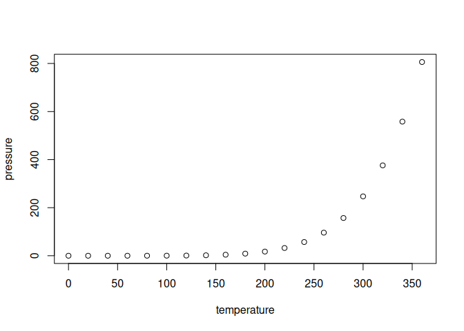

Part 1: Treatment Groups
================
novsers
2026-11-21

## DIG Treatment Groups

There are two treatment groups included in this data: those 
undertaking the digatoxin treatment, and those in the control group. 

## Including Plots

You can also embed plots, for example:

<!-- -->

Note that the `echo = FALSE` parameter was added to the code chunk to
prevent printing of the R code that generated the plot.
